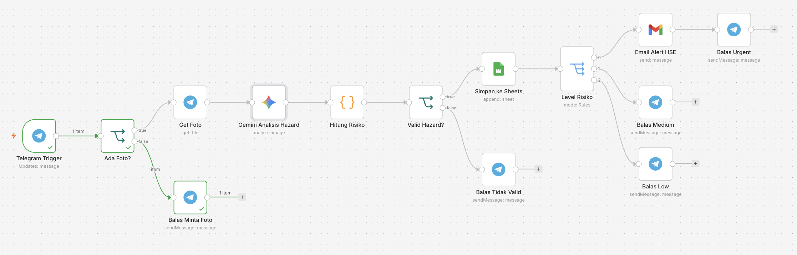
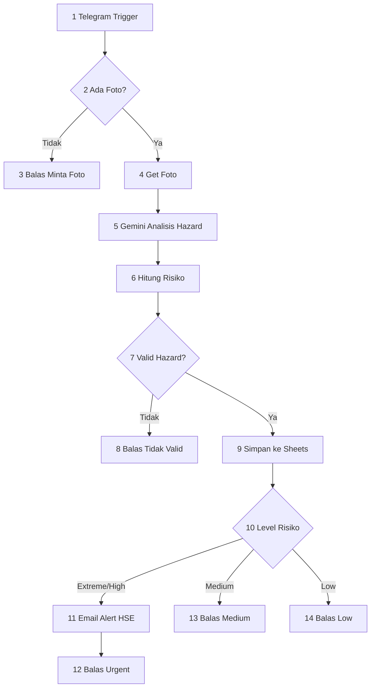
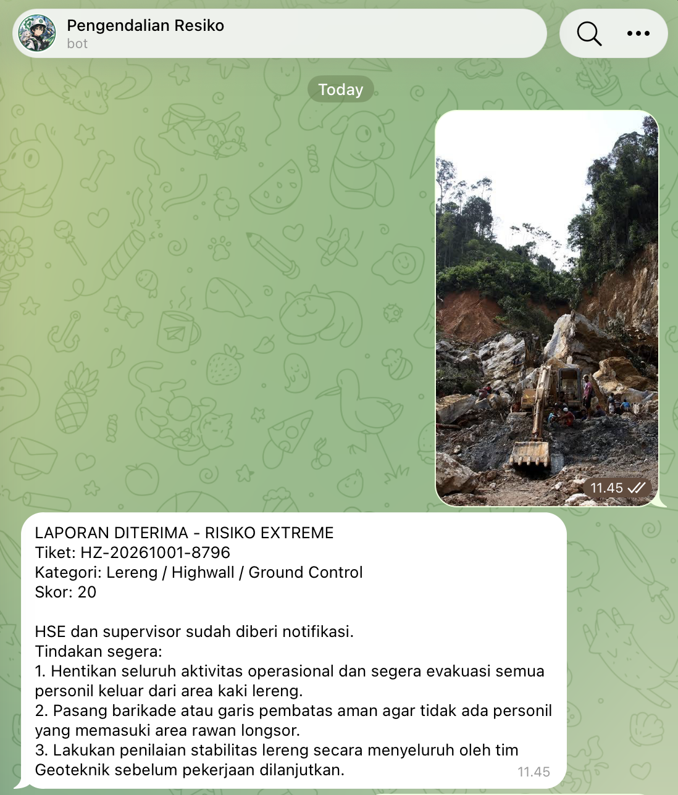
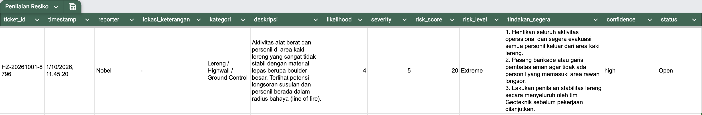
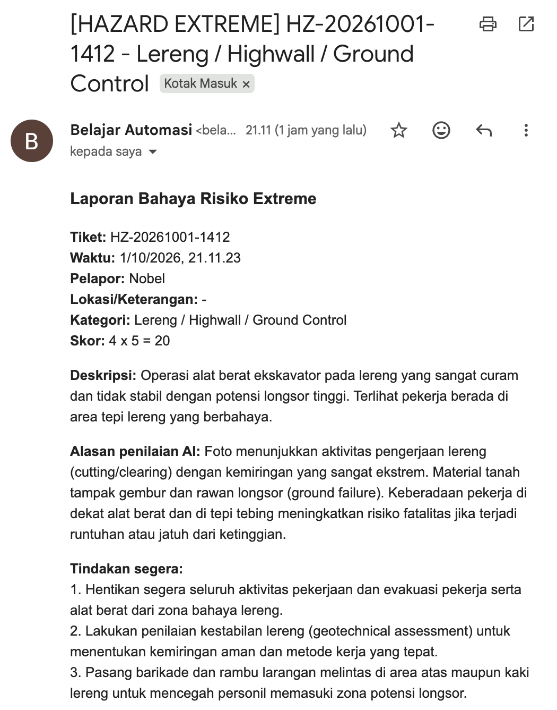
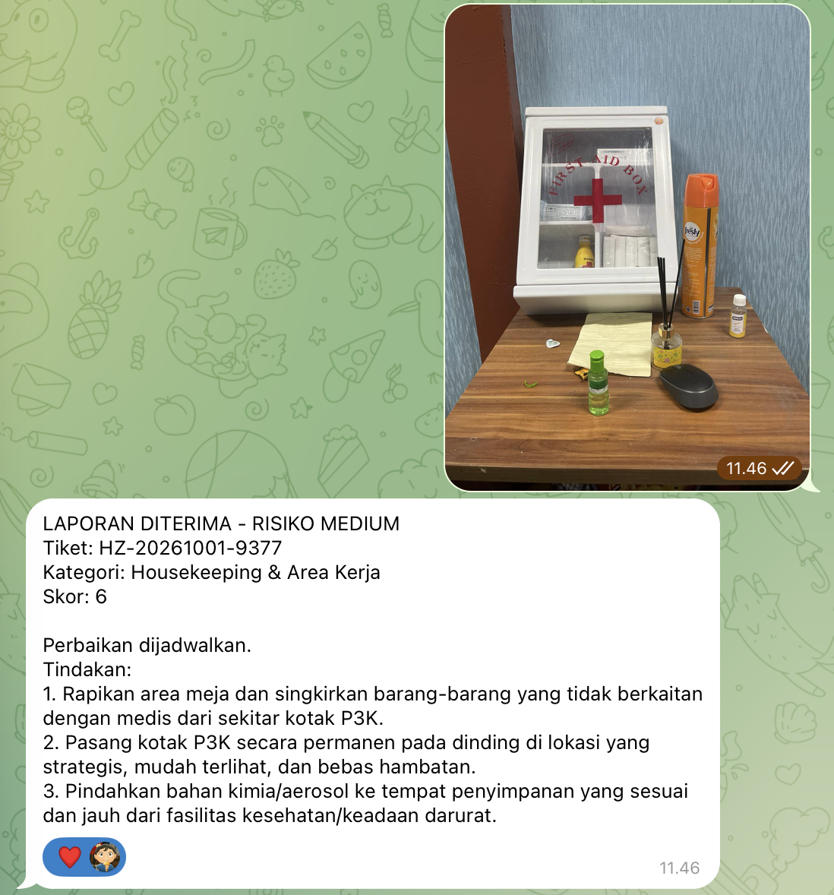
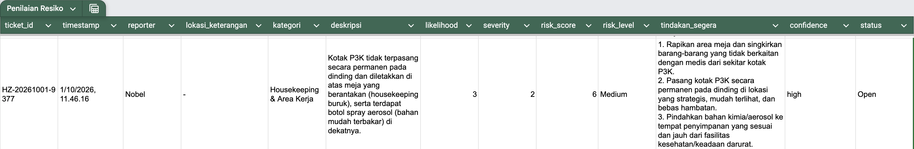
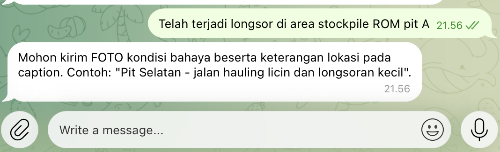

# Hazard Report K3: Penilaian Risiko Otomatis

Workflow **n8n** yang mengubah satu foto laporan bahaya dari lapangan menjadi **tiket terstruktur**, **skor risiko**, **tindakan segera**, dan **alert ke HSE**. Penilaian bahaya dilakukan oleh **Gemini Vision**, dan skor risiko dihitung oleh kode agar konsisten.

**n8n Workflow** : https://nobelalf.app.n8n.cloud/workflow/HnmBo5DTwuemjAKl?projectId=hv8p6Z3EeWcMb6kE



> Final Project AI Automation Engineer PPKD Jakarta Barat dan Hactiv8. Kasus: pelaporan bahaya K3 di tambang terbuka.

## Latar belakang masalah

Pelaporan bahaya di lapangan sering lewat chat pribadi atau kertas. Akibatnya:

- **Lambat sampai ke HSE.** Laporan tenggelam sebelum dibaca orang yang berwenang.
- **Penilaian risiko subjektif.** Tingkat bahaya bergantung pada pelapor, bukan pada matriks risiko yang seragam.
- **Tidak ada rekap terstruktur.** Status sulit dilacak dan bahaya yang berulang tidak terlihat.

Bahaya tingkat High atau Extreme yang terlambat ditangani berisiko menyebabkan kecelakaan dan *stop work*.

| | Manual (chat atau kertas) | Dengan workflow |
|---|---|---|
| Waktu laporan sampai ke HSE | ±30–60 menit* | < 1 menit* |

\*Estimasi, bukan hasil pengukuran.

## Fitur

- Pelapor cukup mengirim **foto + caption lokasi** ke bot Telegram.
- Gemini Vision mengklasifikasi kategori bahaya, menilai *likelihood* dan *severity* (skala 1–5), dan menyarankan maksimal 3 tindakan segera.
- Node Code menghitung **skor = likelihood × severity**, menentukan level risiko, dan membuat **Ticket ID**.
- Semua tiket valid tercatat di **Google Sheets** dengan status `Open`.
- Risiko **High** dan **Extreme** memicu **email alert** ke HSE dan balasan urgent ke pelapor.
- Input tidak valid (tanpa foto, foto buram, atau bukan bahaya) ditolak dengan pesan yang jelas.

## Alur workflow



**Logika kondisi:** 2 node IF (ada foto, valid hazard) dan 1 node Switch (level risiko).

**Keputusan desain:** Gemini hanya menilai *likelihood* dan *severity*. Perkalian skor dan penentuan level dilakukan node Code, karena LLM kurang andal untuk aritmatika dan aturan tetap. Hasilnya konsisten dan bisa diaudit.

## Teknologi

| Komponen | Peran |
|---|---|
| [n8n](https://n8n.io) | Platform otomasi dan orkestrasi workflow |
| Google Gemini (Vision) | Menganalisis foto dan caption, mengeluarkan penilaian dalam JSON |
| Telegram Bot | Input laporan dan balasan ke pelapor |
| Google Sheets | Database tiket |
| Gmail | Alert email untuk risiko High dan Extreme |

## Matriks risiko

Skor = Likelihood (1–5) × Severity (1–5).

| Skor | Level | Tindakan |
|---|---|---|
| 1–4 | Low | Catat, tindak lanjut rutin |
| 5–9 | Medium | Perbaikan terjadwal |
| 10–16 | High | Tindakan segera, lapor supervisor |
| 17–25 | Extreme | Hentikan pekerjaan di area, eskalasi ke HSE |

Matriks ini bersifat umum. Ubah batas skor di node `Hitung Risiko` jika organisasi Anda memakai matriks sendiri.

## Prompt Gemini

<details>
<summary>Lihat prompt lengkap</summary>

```text
ROLE:
Kamu adalah HSE Officer berpengalaman di tambang batubara terbuka (open pit). Tugasmu adalah menganalisis foto dan keterangan dari pekerja untuk mengidentifikasi bahaya atau insiden K3.

KONTEKS:
Laporan berasal dari pekerja lapangan via Telegram.
Keterangan pelapor (caption): " {{ $('Telegram Trigger').item.json.message.caption || '-' }} "

TUGAS:
1. Tentukan apakah foto/caption menunjukkan kondisi berbahaya, tindakan tidak aman, atau kecelakaan kerja (is_valid_hazard).
2. Klasifikasikan ke dalam SATU kategori yang paling relevan dari daftar berikut:
   - Kecelakaan Kerja / Insiden (Gunakan jika sudah terjadi cedera, korban jatuh, tergeletak, atau kontak fisik berbahaya)
   - Bekerja di Ketinggian / Fall Hazard (Struktur, platform, tangga, rigging)
   - Jalan Hauling / Transportasi Tambang
   - Lereng / Highwall / Ground Control
   - Alat Berat & Unit Operasional
   - Kelistrikan & Energi
   - Bahan Kimia / B3 / Kebakaran
   - Housekeeping & Area Kerja
   - APD / Alat Pelindung Diri
   - Lainnya (Gunakan HANYA jika tidak sesuai dengan opsi di atas)
3. Nilai Likelihood (1-5) dan Severity (1-5):
   - Likelihood (Kemungkinan): 1 = Sangat Jarang ... 5 = Hampir Pasti / Sudah Terjadi
   - Severity (Dampak): 1 = Tanpa Pertolongan Pertama ... 5 = Fatalitas / Kecelakaan Berat / Duka Cita
   *Catatan: Jika foto/caption menunjukkan insiden yang SUDAH TERJADI (seperti pekerja terjatuh/pingsan), beri Severity tinggi (4-5) dan Likelihood (4-5).*
4. Berikan maksimal 3 tindakan pengendalian / tanggap darurat segera, urut berdasarkan prioritas tercepat.

ATURAN:
- Analisis berdasarkan bukti fisik visual di foto dan penjelasan di caption.
- Jika ada indikasi korban cedera/terjatuh, prioritaskan tindakan Tanggap Darurat (ERT/Medis).
- Jika foto buram atau tidak jelas, set confidence "low" dan needs_more_info true.
- Jawab dalam Bahasa Indonesia.

FORMAT OUTPUT (HANYA JSON valid, tanpa format markdown ```json):
{
  "is_valid_hazard": true,
  "category": "",
  "description": "",
  "likelihood": 0,
  "severity": 0,
  "reasoning": "",
  "immediate_actions": ["", "", ""],
  "confidence": "high|medium|low",
  "needs_more_info": false
}
```

</details>

Alasan desain:

- **Role dan konteks** memberi sudut pandang HSE dan domain tambang.
- **Skala berjangkar** (arti angka 1 dan 5 dijelaskan) membuat penilaian konsisten.
- **Kategori tertutup** membuat data di Sheets seragam.
- **Aturan konservatif**: jika ragu, pilih yang lebih berbahaya. Di K3, peringatan berlebih lebih aman daripada terlewat.
- **Format JSON ketat** agar langsung diproses node Code.
- **`confidence` dan `needs_more_info`** menangani foto buruk secara jujur.

## Struktur data Google Sheets

| Kolom | Isi |
|---|---|
| `ticket_id` | Contoh `HZ-20261001-3392` |
| `timestamp` | Waktu laporan (Asia/Jakarta) |
| `reporter` | Nama pelapor dari Telegram |
| `lokasi_keterangan` | Caption yang dikirim pelapor |
| `kategori` | Kategori bahaya dari Gemini |
| `deskripsi` | Deskripsi kondisi bahaya |
| `likelihood` | 1–5 |
| `severity` | 1–5 |
| `risk_score` | likelihood × severity |
| `risk_level` | Low, Medium, High, atau Extreme |
| `tindakan_segera` | Daftar tindakan bernomor |
| `confidence` | high, medium, atau low |
| `status` | Default `Open` |

## Instalasi

### Prasyarat

- Instance n8n (Cloud, atau self-hosted dengan alamat **HTTPS** publik agar webhook Telegram berfungsi)
- Bot Telegram (buat lewat `@BotFather`, simpan token)
- API key Gemini dari [Google AI Studio](https://aistudio.google.com)
- Akun Google dengan Gmail API, Google Sheets API, dan Google Drive API yang sudah diaktifkan di Cloud Console, serta OAuth client

### Langkah

1. Buat spreadsheet baru dengan tab `Hazard Log` dan 13 header di atas. Salin ID spreadsheet dari URL.
2. Di n8n, buka **Workflows > Add workflow > ⋯ > Import from file**, lalu pilih `hazard_report_workflow.json`.
3. Buat dan pilih empat kredensial: **Telegram API**, **Google Gemini (PaLM) API**, **Google Sheets OAuth2**, dan **Gmail OAuth2**.
4. Ganti dua placeholder:
   - Node `Simpan ke Sheets`: `GANTI_DENGAN_ID_GOOGLE_SHEET` dengan ID spreadsheet Anda.
   - Node `Email Alert HSE`: `GANTI_DENGAN_EMAIL_TUJUAN@example.com` dengan email penerima alert.
5. Uji dengan **Execute workflow**, lalu aktifkan toggle **Active**.

## Cara penggunaan

1. Buka bot Telegram Anda dan tekan **Start**.
2. Kirim **foto** (sebagai Photo, bukan File) dengan caption lokasi, misalnya `Pit Selatan - jalan hauling licin dan longsoran kecil`.
3. Bot membalas dalam beberapa detik. Contoh balasan untuk risiko High:

```text
LAPORAN DITERIMA - RISIKO HIGH
Tiket: HZ-20261001-3392
Kategori: Lereng/Highwall
Skor: 12

HSE dan supervisor sudah diberi notifikasi.
Tindakan segera:
1. ...
2. ...
```

## Skenario uji

| # | Input | Hasil yang benar |
|---|---|---|
| 1 | Pesan teks tanpa foto | Bot meminta foto. Tidak ada baris baru di Sheets. |
| 2 | Foto non-bahaya | Bot membalas foto tidak valid. Tidak ada baris baru. |
| 3 | Foto bahaya tinggi (lereng retak, jalan longsor) | Baris baru di Sheets, email alert masuk, balasan urgent. |
| 4 | Foto kotak P#K (alat berserakan) | Baris baru di Sheets, balasan Low. Tidak ada email. |

## Tangkapan layar

| Input | Output |
|---|---|
|  |   |
|  |  |
|  | Output langsung berupa pesan. |

## Struktur repositori

```text
.
├── README.md
├── hazard_report_workflow.json   # workflow n8n siap impor
└── docs/                         # screenshot dan materi presentasi
```

## Batasan

- Penilaian Gemini berdasarkan satu foto dan caption, jadi tidak menggantikan inspeksi dan keputusan petugas K3.
- Angka waktu pada bagian latar belakang adalah estimasi.
- Ticket ID memakai angka acak 4 digit, cukup untuk demo tetapi bukan penomoran yang dijamin unik di skala produksi.
- Kuota gratis Gemini dapat membatasi jumlah laporan per menit.

## Pengembangan lanjutan

- Perluas cakupan ke lingkungan kerja lain (pabrik, gudang, konstruksi, perkantoran) dengan kategori bahaya umum dan field `work_environment`.
- Rekap harian atau mingguan otomatis ke supervisor.
- Notifikasi eskalasi jika tiket `Open` melewati batas waktu.
- Penanganan error pada node Gemini (balasan "sistem sibuk").

## Penulis

[Nobel Alief Lie, S.T.]